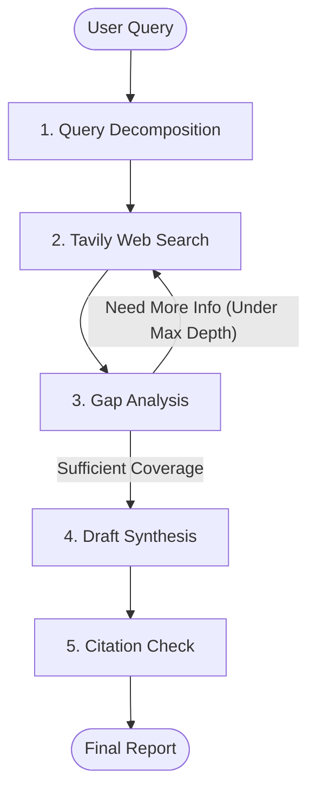

# Deep Research Agent with LangGraph

A multi-step web research agent built with LangGraph, LangChain, and Tavily Search. It takes a research query, breaks it down into multiple sub-queries, searches the web across iterative reflection cycles, and generates a cited report with a citation verification pass.

---

## How It Works

Single-prompt search workflows often run into issues: a single query usually misses broader context, the model has no way to evaluate if it gathered enough evidence, and LLMs frequently fabricate citation numbers.

This agent uses a cyclic LangGraph state machine to handle research in steps:



1. **Decompose**: Breaks the main topic into 3 targeted sub-queries covering foundations, recent updates, and limitations.
2. **Search**: Queries Tavily for each topic and deduplicates results by URL.
3. **Evaluate**: Reviews gathered snippets to check if critical context is missing. If gaps exist and the run has not hit the iteration limit, it generates follow-up queries and loops back to search.
4. **Synthesize**: Writes a structured technical draft with numbered inline citations.
5. **Verify**: Checks citation numbers against the retrieved sources and audits claims against source text before producing the final report.

---

## Project Structure

```
web-research-agent/
├── agent.py            # LangGraph workflow, nodes, and CLI execution
├── app.py              # Streamlit interface with live event streaming
├── requirements.txt    # Project dependencies
├── .env.example        # Environment variable template
├── .gitignore          # Git ignore rules
└── README.md           # Documentation
```

---

## Setup

### Prerequisites
- Python 3.10+
- OpenAI API key
- Tavily API key

### Installation
```bash
git clone https://github.com/vikasjoshi2027/web-research-agent.git
cd web-research-agent
pip install -r requirements.txt
```

### Environment Configuration
Copy `.env.example` to `.env`:
```bash
cp .env.example .env
```

Add your keys to `.env`:
```env
OPENAI_API_KEY=your_openai_api_key_here
TAVILY_API_KEY=your_tavily_api_key_here
OPENAI_MODEL=gpt-4o-mini
```

---

## Usage

### CLI
Run research tasks directly in your terminal:
```bash
# Default topic
python agent.py

# Custom topic with a limit of 2 search cycles
python agent.py --query "Recent developments in test-time compute scaling for LLMs" --max-iterations 2
```

### Streamlit Web App
Launch the web interface:
```bash
streamlit run app.py
```
The Streamlit app streams node updates as each step finishes, lists all consulted sources with URLs, and lets you export the final report as Markdown.

---

## Limitations

A few practical limitations to keep in mind:

- Search results rely on Tavily's returned snippet previews rather than full webpage scraping. If a source is behind a paywall or requires deep page crawling, the agent only sees the short summary snippet.
- The verification step checks if cited claims match retrieved snippets, but it cannot guarantee 100% factual accuracy if the source itself is incorrect or ambiguous.
- Sub-queries in the search step currently run sequentially rather than in parallel, which adds a few seconds of latency per cycle.
- Token usage scales with each reflection cycle, so it is best to keep `max_iterations` around 1 or 2 when testing.

---

## License

MIT License. See [LICENSE](LICENSE) for details.